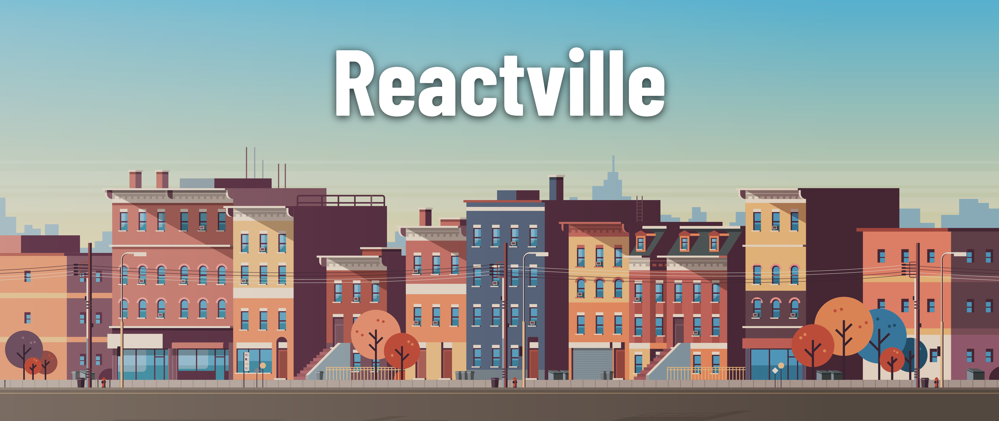

<h1>
  
  React Router DOM Lab
</h1>

## About

Welcome to Reactville, a constantly evolving virtual metropolis. Let's build this digital town together, one component at a time.

Welcome to Reactville's local post office! In this lab, you'll develop an application that simulates the management of post office boxes. Features will include creating new mailboxes, viewing a list of all mailboxes, and exploring individual mailbox details.

Throughout the lab, you'll use client-side routing tools from the React Router library to navigate between different components. This approach allows your single-page application to function more like a traditional multi-page website, improving the user experience by providing distinct navigable pages without full page reloads.

## Content

- [Setup](./setup/README.md)
- [Exercise](./exercise/README.md)
- [Send and Receive Letters Exercise](./send-and-receive-letters-exercise/README.md)

## Internal

### Prerequisites

- Controlled Forms in React
- Lifting State in React
- React Router DOM

### Time to complete

Estimated time to complete core lab exercise: **2 hrs**

### Solution code

🏁 [Solution code](https://git.generalassemb.ly/modular-curriculum-all-courses/react-router-dom-lab-solution)

### Course landing pages

- [SEB - Software Engineering Bootcamp](https://ga-curriculum.github.io/react-router-dom-lab/canvas-landing-pages/seb.html)
- [RDS - React Development Short Course](https://ga-curriculum.github.io/react-router-dom-lab/canvas-landing-pages/rds.html)
- [Fallback](https://ga-curriculum.github.io/react-router-dom-lab/canvas-landing-pages/fallback.html)

### Resources

✏️ [Instructor Guide](./internal-resources/instructor-guide.md)

🎥 [Video Hub](./internal-resources/video-hub.md)

🏗️ [Release Notes](./internal-resources/release-notes.md)

---

**Find a 👾 bug 👾 or have suggestions? [Let us know](https://ga-curriculum.github.io/universal-resources-internal/module-feedback.html)!**
